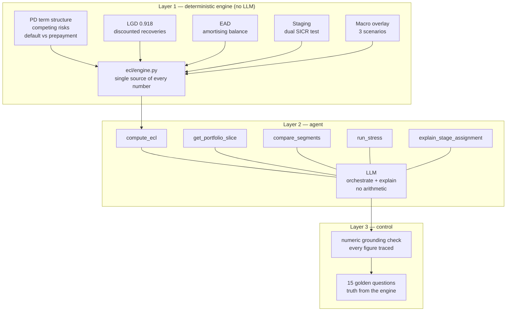

# Credit Risk Copilot

An IFRS 9 expected credit loss engine for a $9.5bn consumer loan book, with a
language model layer that can only orchestrate and explain, never compute.

**Live app:** https://credit-risk-copilot-8pxs83jr3yvbdmashappsfr.streamlit.app

*The chat panel runs on a free-tier LLM key. If it rate-limits, the engine
dashboard is unaffected: every figure on the left is computed without the
model. That separation is the point of the project.*

**In brief.** A deterministic Python engine produces a probability-weighted
provision of $905.4m on 912,609 LendingClub loans across three macro scenarios.
A tool-calling LLM agent answers questions about it, and a guardrail checks that
every figure in each answer traces to a tool result. Validation is reported
honestly: ranking power holds out-of-time, but the PD level under-predicts
defaults on later vintages (see "Three ways this breaks").

---

## The question

Banks are under pressure to put language models in front of regulated numbers.
The obvious failure mode is an assistant that produces a fluent, confident,
wrong provision figure.

This project takes the position that the split has to be structural rather than
instructed. A deterministic engine owns every computation. The model receives
tool outputs and explains them. Then a guardrail verifies, on every answer, that
each figure traces back to something a tool actually returned.

---

## Headline

| | |
|---|---|
| Exposure at default | **$9,510,384,856** |
| Loans | 912,609 |
| Probability-weighted ECL | **$905.4m** |
| Coverage ratio | **9.52%** |
| Reporting date | 31 December 2018 |

| Stage | EAD | Base | Adverse | Severe | Coverage (base) |
|---|---|---|---|---|---|
| 1 | $7,767.3m | $292.9m | $399.1m | $535.2m | 3.77% |
| 2 | $1,498.4m | $254.0m | $338.1m | $439.0m | 16.95% |
| 3 | $244.6m | $224.6m | $229.5m | $234.4m | 91.80% |
| **Total** | **$9,510.4m** | **$771.4m** | **$966.7m** | **$1,208.6m** | **8.11%** |

Scenario weights 50 / 35 / 15. Stage 3 coverage equals LGD exactly, because PD
is 1 by definition.

---

## Data

LendingClub accepted loans 2007-2018Q4, Kaggle `wordsforthewise/lending-club`,
CC0. Public only, no proprietary data.

2,260,701 records split into a **modelling set** (1,345,310 closed loans, used
to fit PD and LGD) and a **live book** (912,609 loans open at the snapshot, on
which ECL is computed). The file is a snapshot rather than a panel, so this
split (estimate on closed cohorts, apply to the current book) is what makes
lifetime PD estimable at all.

---

## Architecture



The agent panel and the engine panel sit side by side in the app deliberately.
Pull the API key and every number still renders; only the chat degrades.

---

## Three ways this breaks

**1. The vintage gap, and it is measurable.** PD is fitted on 2007-2015
vintages and applied to a book that is 94% 2016-2018 originations by exposure.
Refitting the PD curves on loans issued through 2013 and testing on 2014-2015,
the model under-predicts lifetime default by **2.02pp (14% relative)**:
12.44% predicted against 14.46% actual. The shortfall is concentrated in the
riskier grades (grade C -3.0pp, grade E -8.3pp, grade G -11.5pp) while grade A
is accurate (+0.19pp). Ranking power did not degrade over the same split, so
the failure is one of level, not of ordering. The live book sits further from
the fitting window than this test does, so the drift there cannot be measured
from this dataset.

This does not by itself say which way the provision is wrong. Vintage drift
points toward understatement. The conservative Stage 3 definition (the whole
31-120 days-past-due band is treated as defaulted, and Stage 3 is 29% of the
base-scenario provision) points toward overstatement. The net direction is not
established. How sensitive the provision is to a PD shock of this size can be
read from the `run_stress` tool.

**2. The macro overlay is asserted, not estimated.** The 1.35x and 1.80x PD
scalars are judgement. The panel holds one crisis, at the very start, when the
book was small and unseasoned, followed by a decade of falling unemployment.
Fitting an unemployment elasticity on that would be presenting noise as a
coefficient. The provision moves materially with numbers nobody measured. That
is disclosed rather than hidden, but it is still true.

**3. The guardrail checks figures, not mechanisms.** During development the
agent wrote a fully cited answer describing exposure "migrating to Stages 2 and
3 under stress". Staging here is computed once and is scenario-invariant, so
nothing migrates. Every number was grounded; the causal story was fabricated. No
numeric check catches that class of error, and anyone relying on one should know
it.

---

## Evaluation

15 golden questions. Truth values are computed by calling the engine at
evaluation time rather than hardcoded, so the eval cannot drift when a parameter
changes. Two questions are unanswerable and must be refused.

| Run | Accuracy | Grounding | Tool selection | What changed |
|---|---|---|---|---|
| 1 | 14/15 | 13/15 | 14/15 | baseline |
| 2 | 15/15 | 14/15 | 13/15 | added `compare_segments`, share fields, loan-id lookup |
| 3 | **15/15** | **14/15** | **15/15** | fixed a checker false positive on string-embedded numbers |

108 figures checked in the final run, 1 ungrounded.

**What these numbers do and do not show.** "Accuracy" means the engine's truth
value appears in the answer. The tools and the expected-tool lists were adjusted
while iterating on these same 15 questions, so this is development-set
performance, not a held-out result. Results are from one model
(`gemini-3.5-flash-lite`, temperature 0).

### Failure taxonomy

**Prohibited arithmetic** — the dominant mode, three instances across two
models. The agent divided one grounded figure by another to produce share-of-
total and coverage ratios. Both inputs traced; the output existed nowhere.

The fix was not a sterner instruction. The agent was doing arithmetic precisely
where the engine left a gap, so the gap was closed: `compare_segments` returns
ratios and differences already computed, `compute_ecl` returns share fields, and
`get_portfolio_slice` returns loan ids. Violations went to zero.
**Prompts are advisory. API surface is structural.**

**Mechanism hallucination** — one instance, uncaught by design. See "Three ways
this breaks".

**Sign inversion** — one instance, open. `compare_segments` returned -21.9383
(A minus G); the agent reported 21.9383 as "G is higher". Trivially safe, still
a transformation, still flagged. Left unfixed because closing it would be
optimising the eval rather than the model.

**Checker false positive** — loan ids and PD ratios appear in tool results only
inside strings, and the extractor originally walked numeric leaves only. Fixed.

---

## Model summary

| Component | Approach | Key figure |
|---|---|---|
| PD | Discrete-time competing risks, default vs prepayment, fitted on fully seasoned vintages | in-sample calibration error 0.051% (max); out-of-time AUC 0.661, level under-predicted 2.0pp |
| LGD | Discounted realised recoveries, seasoned charge-offs | 0.9180 portfolio |
| EAD | Contractual amortising balance at loan EIR | n/a |
| SICR | Dual relative (2.0x) / absolute (5pp), continuous FICO-elasticity PD multiplier | beta = 0.01006, weighted R2 0.995 on 18 FICO bins |
| Macro | Three scenarios, judgemental scalars applied to the hazard | 1.00 / 1.35 / 1.80 |

Three designs were built and rejected along the way, each for a reason recorded
in the code: prepayment-as-censoring PD (overstated cumulative PD by up to
15.8pp), relative-only SICR (structurally exempted grade G), and implied-grade
deterioration (grade scale has no room below G). See
`docs/model_validation_note.md`.

---

## Validation

Out-of-time split. The competing-risks PD curves are **refitted on loans
issued through 2013 only**, then used to score 445,596 36-month loans issued in
2014-2015. No post-origination feature enters the score.

> **Correction.** An earlier version of this validation scored the test loans
> with curves fitted on all vintages, which included the test loans. That
> understated the calibration gap (-0.61pp). The corrected figure is -2.02pp.

| Model | Sample | AUC | Gini | KS |
|---|---|---|---|---|
| Grade x term PD | **out-of-time** | **0.6608** | **0.3216** | **0.2522** |
| Grade x term PD | in-sample (36m) | 0.6282 | 0.2564 | 0.1999 |
| Logistic benchmark, 12 features | out-of-time | 0.6678 | 0.3355 | 0.2452 |
| Logistic benchmark, 12 features | in-sample (36m) | 0.6610 | 0.3220 | 0.2357 |

In-sample rows use 36-month train loans only, so they are comparable with the
36-month test set.

**Ranking held.** Out-of-time AUC is not lower than in-sample AUC for either
model; grade was somewhat more informative on the 2014-2015 vintages than on
earlier ones.

**The scorecard barely beats it.** Twelve fitted origination features gain
0.0070 AUC over seven grade buckets out-of-time. LendingClub's grade is
assigned from those same fields, so it already carries nearly all the signal.
The scorecard was built, compared, and did not earn its complexity.

**AUC 0.66 is bounded by design**, not by fitting: grade and term give seven
distinct scores. For a provision model that is the right trade, because ECL
needs the default RATE correct in level rather than a sharp ranking. Both
properties are reported because a model calibrated on average can still rank
randomly, and a model that ranks well can still miss on level, as this one does.

**Out-of-time calibration, by grade:**

| Grade | n | Predicted | Actual | Gap (pp) |
|---|---|---|---|---|
| A | 105,451 | 5.60% | 5.41% | +0.19 |
| B | 145,185 | 10.52% | 11.46% | -0.94 |
| C | 121,465 | 15.62% | 18.63% | -3.00 |
| D | 53,221 | 20.03% | 24.66% | -4.63 |
| E | 16,509 | 22.07% | 30.35% | -8.28 |
| F | 3,341 | 25.33% | 34.75% | -9.42 |
| G | 424 | 30.53% | 41.98% | -11.45 |
| **All** | **445,596** | **12.44%** | **14.46%** | **-2.02** |

The model under-predicts default in every grade except A, and the gap widens
with risk. Detail in `docs/pd_discrimination.md`.

---

## Repository

```
ecl/          deterministic engine: config, schema, engine
agent/        tool schemas, prompts, runner, guardrail
evals/        golden questions, harness, results
tests/        regression tests for the engine and guardrail
notebooks/    00-09, the build pipeline in order
docs/         model validation note, PD discrimination report
app.py        Streamlit front end
DEPLOY.md     deployment runbook
```

## Running it

```bash
python -m venv .venv && .venv/Scripts/activate
pip install -r requirements.txt

# download the Kaggle dataset to data/raw/ first, then:
python notebooks/00_schema_audit.py
python notebooks/01_split.py
python notebooks/02_pd_curves.py
python notebooks/03_lgd.py
python notebooks/04_staging.py
python notebooks/05_run_ecl.py
python notebooks/07_build_deploy_artifact.py
python notebooks/08_pd_discrimination.py
python notebooks/09_plot_pd_curves.py

python tests/test_engine.py
python evals/run_eval.py

streamlit run app.py
```

The agent layer needs an LLM key in `.env`:

```
LLM_PROVIDER=gemini
GEMINI_API_KEY=...
ECL_AGENT_MODEL=gemini-3.5-flash-lite
```

`LLM_PROVIDER=anthropic` also works; nothing outside `agent/runner.py` is
coupled to a vendor.

---

## Not production

Single reporting date, no backtest against realised provisions, no roll rates.
Out-of-time validation covers the PD model only (36-month loans, 2014-2015).
Built as a portfolio project on public data. Limitations are catalogued in
`docs/model_validation_note.md` rather than omitted.