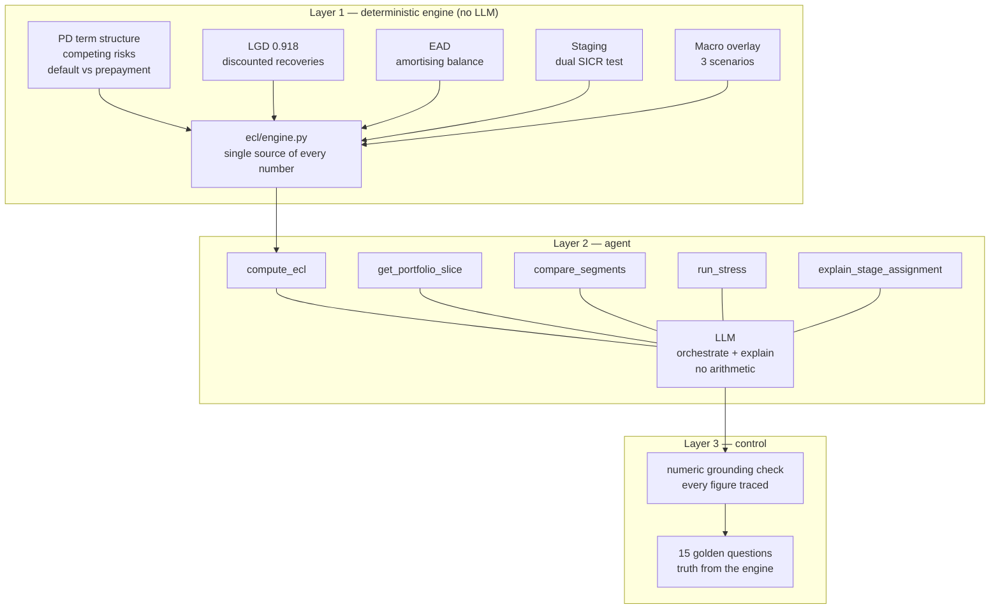

# Credit Risk Copilot

An IFRS 9 expected credit loss engine for a $9.5bn consumer loan book, with a
language model layer that can only orchestrate and explain — never compute.

**Live app:** _add your Streamlit URL here_

---

## The question

Banks are under pressure to put language models in front of regulated numbers.
The obvious failure mode is an assistant that produces a fluent, confident,
wrong provision figure.

This project takes the position that the split has to be structural rather than
instructed. A deterministic engine owns every computation. The model receives
tool outputs and explains them. Then a guardrail verifies, on every answer, that
each figure traces back to something a tool actually returned.

The engine is real. It is not a default-prediction notebook with an IFRS 9 label
on it.

---

## Headline

| | |
|---|---|
| Exposure at default | **$9,510,384,856** |
| Loans | 912,609 |
| Probability-weighted ECL | **$905.4m** |
| Coverage ratio | **9.52%** |
| Reporting date | 31 December 2018 |

| Stage | EAD | Base | Adverse | Severe | Coverage (base) |
|---|---|---|---|---|---|
| 1 | $7,767.3m | $292.9m | $399.1m | $535.2m | 3.77% |
| 2 | $1,498.4m | $254.0m | $338.1m | $439.0m | 16.95% |
| 3 | $244.6m | $224.6m | $229.5m | $234.4m | 91.80% |
| **Total** | **$9,510.4m** | **$771.4m** | **$966.7m** | **$1,208.6m** | **8.11%** |

Scenario weights 50 / 35 / 15. Stage 3 coverage equals LGD exactly, because PD
is 1 by definition.

---

## Data

LendingClub accepted loans 2007-2018Q4, Kaggle `wordsforthewise/lending-club`,
CC0. Public only, no proprietary data.

2,260,701 records split into a **modelling set** (1,345,310 closed loans, used
to fit PD and LGD) and a **live book** (912,609 loans open at the snapshot, on
which ECL is computed). The file is a snapshot rather than a panel, so this
split — estimate on closed cohorts, apply to the current book — is what makes
lifetime PD estimable at all.

---

## Architecture



The agent panel and the engine panel sit side by side in the app deliberately.
Pull the API key and every number still renders; only the chat degrades.

---

## Three ways this breaks

**1. The vintage gap, and it is measurable.** PD is fitted on 2007-2015
vintages and applied to a book that is 94% 2016-2018 originations by exposure.
Training on 2007-2013 and testing on 2014-2015, the model under-predicts the
default rate by **0.61pp (4.4% relative)**, systematically across nine of ten
deciles. The live book sits further from the fitting window still, so the drift
is plausibly larger. **The $905.4m provision is more likely understated than
overstated.** Not fixable within a dataset that ends in 2018Q4 with no seasoned
post-2015 cohort to test against.

**2. The macro overlay is asserted, not estimated.** The 1.35x and 1.80x PD
scalars are judgement. The panel holds one crisis, at the very start, when the
book was small and unseasoned, followed by a decade of falling unemployment.
Fitting an unemployment elasticity on that would be presenting noise as a
coefficient. The provision moves materially with numbers nobody measured — that
is disclosed rather than hidden, but it is still true.

**3. The guardrail checks figures, not mechanisms.** During development the
agent wrote a fully cited answer describing exposure "migrating to Stages 2 and
3 under stress". Staging here is computed once and is scenario-invariant, so
nothing migrates. Every number was grounded; the causal story was fabricated. No
numeric check catches that class of error, and anyone relying on one should know
it.

---

## Evaluation

15 golden questions. Truth values are computed by calling the engine at
evaluation time rather than hardcoded, so the eval cannot drift when a parameter
changes. Two questions are unanswerable and must be refused.

| Run | Accuracy | Grounding | Tool selection | What changed |
|---|---|---|---|---|
| 1 | 14/15 | 13/15 | 14/15 | baseline |
| 2 | 15/15 | 14/15 | 13/15 | added `compare_segments`, share fields, loan-id lookup |
| 3 | **15/15** | **14/15** | **15/15** | fixed a checker false positive on string-embedded numbers |

108 figures checked in the final run, 1 ungrounded.

### Failure taxonomy

**Prohibited arithmetic** — the dominant mode, three instances across two
models. The agent divided one grounded figure by another to produce share-of-
total and coverage ratios. Both inputs traced; the output existed nowhere.

The fix was not a sterner instruction. The agent was doing arithmetic precisely
where the engine left a gap, so the gap was closed: `compare_segments` returns
ratios and differences already computed, `compute_ecl` returns share fields, and
`get_portfolio_slice` returns loan ids. Violations went to zero.
**Prompts are advisory. API surface is structural.**

**Mechanism hallucination** — one instance, uncaught by design. See "Three ways
this breaks".

**Sign inversion** — one instance, open. `compare_segments` returned −21.9383
(A minus G); the agent reported 21.9383 as "G is higher". Trivially safe, still
a transformation, still flagged. Left unfixed because closing it would be
optimising the eval rather than the model.

**Checker false positive** — loan ids and PD ratios appear in tool results only
inside strings, and the extractor originally walked numeric leaves only. Fixed.

---

## Model summary

| Component | Approach | Key figure |
|---|---|---|
| PD | Discrete-time competing risks, default vs prepayment, fitted on fully seasoned vintages | max calibration error 0.051%; out-of-time AUC 0.661 |
| LGD | Discounted realised recoveries, seasoned charge-offs | 0.9180 portfolio |
| EAD | Contractual amortising balance at loan EIR | — |
| SICR | Dual relative (2.0x) / absolute (5pp), continuous FICO-elasticity PD multiplier | β = 0.01006, R² 0.995 |
| Macro | Three scenarios, judgemental scalars applied to the hazard | 1.00 / 1.35 / 1.80 |

Three designs were built and rejected along the way, each for a reason recorded
in the code: prepayment-as-censoring PD (overstated cumulative PD by up to
15.8pp), relative-only SICR (structurally exempted grade G), and implied-grade
deterioration (grade scale has no room below G). See
`docs/model_validation_note.md`.

---

## Validation

Out-of-time split: fitted on loans issued through 2013, tested on 445,596
36-month loans issued 2014-2015 that the model never saw. No post-origination
feature enters the score.

| Model | Sample | AUC | Gini | KS |
|---|---|---|---|---|
| Grade x term PD | **out-of-time** | **0.6608** | **0.3216** | **0.2522** |
| Grade x term PD | in-sample | 0.6609 | 0.3217 | 0.2362 |
| Logistic benchmark, 12 features | out-of-time | 0.6678 | 0.3355 | 0.2452 |
| Logistic benchmark, 12 features | in-sample | 0.6850 | 0.3701 | 0.2679 |

**The model does not overfit.** Out-of-time AUC differs from in-sample by
0.0001; a seven-parameter model has nothing to overfit with. The logistic
benchmark degrades by 0.0172 across the same split.

**The scorecard barely beats it.** Twelve fitted origination features gain
0.0070 AUC over seven grade buckets out-of-time. LendingClub's grade is
assigned from those same fields, so it already carries nearly all the signal.
The scorecard was built, compared, and did not earn its complexity.

**AUC 0.66 is bounded by design**, not by fitting: grade and term give seven
distinct scores. For a provision model that is the right trade, because ECL
needs the default RATE correct in level rather than a sharp ranking. Both
properties are reported because a model calibrated on average can still rank
randomly.

**Out-of-time calibration** predicts 13.85% against an actual 14.46%, a
systematic **-0.61pp under-prediction** across nine of ten deciles. That is the
vintage-drift limitation measured rather than asserted, and it means the
headline provision is more likely understated than overstated. Detail in
`docs/pd_discrimination.md`.

---

## Repository

```
ecl/          deterministic engine — config, schema, engine
agent/        tool schemas, prompts, runner, guardrail
evals/        golden questions, harness, results
notebooks/    00-07, the build pipeline in order
docs/         model validation note, PD discrimination report
app.py        Streamlit front end
DEPLOY.md     deployment runbook
```

## Running it

```bash
python -m venv .venv && .venv/Scripts/activate
pip install -r requirements.txt

# download the Kaggle dataset to data/raw/ first, then:
python notebooks/00_schema_audit.py
python notebooks/01_split.py
python notebooks/02_pd_curves.py
python notebooks/03_lgd.py
python notebooks/04_staging.py
python notebooks/05_run_ecl.py
python notebooks/07_build_deploy_artifact.py
python notebooks/08_pd_discrimination.py

streamlit run app.py
```

The agent layer needs an LLM key in `.env`:

```
LLM_PROVIDER=gemini
GEMINI_API_KEY=...
ECL_AGENT_MODEL=gemini-3.5-flash-lite
```

`LLM_PROVIDER=anthropic` also works; nothing outside `agent/runner.py` is
coupled to a vendor.

---

## Not production

Single reporting date, no backtest, no out-of-time validation, no roll rates.
Built as a portfolio project on public data. Limitations are catalogued in
`docs/model_validation_note.md` rather than omitted.
